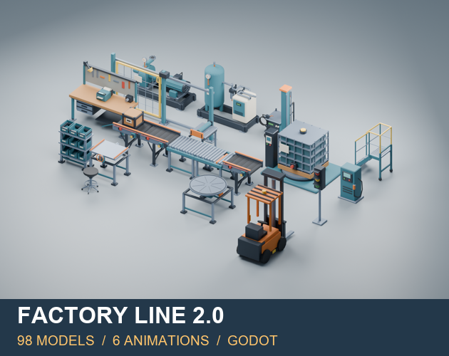
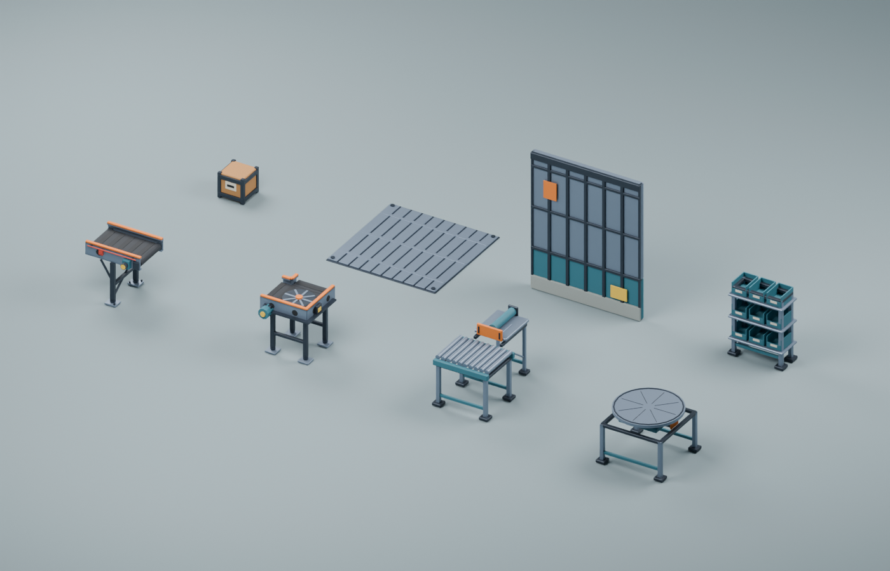
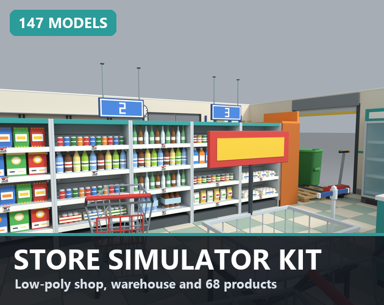
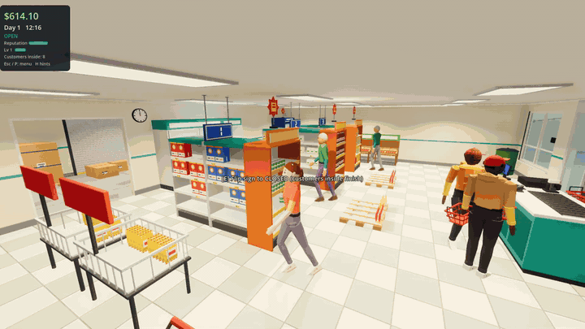

# Tiny Shift Assets — Low-poly 3D kits and working Godot 4 templates

Low-poly 3D asset packs (Blender, GLB/FBX, Godot scenes) and playable Godot 4 templates for **shop, factory and simulator games**. Sold on itch.io by **Shapita**: https://shapita.itch.io/

> **AI disclosure:** these assets and templates are made with an AI-assisted workflow. Every image here is a real render or capture of the delivered content.

## Free samples (start here)

| Free sample | What you get | Link |
|---|---|---|
| Store Simulator Kit Lite | 44 free low-poly retail assets: shelves, fridges, checkout, boxes | https://shapita.itch.io/store-simulator-kit-lite |
| Factory Line sample + import guide | 8 free industrial models + 2 clips, step-by-step import into Godot/Blender | https://shapita.itch.io/factory-line-3d/devlog/1745907/prototype-a-factory-scene-with-8-free-3d-models-an-import-first-guide |
| Garden Market | 20 free low-poly market props | https://shapita.itch.io/garden-market-3d |

## Factory and industrial

- **Factory Line** — 98 low-poly industrial models + 6 animation clips, Godot scenes/prefabs. Art pack, not a working simulation. US$1.99 — https://shapita.itch.io/factory-line-3d
- **Industrial World bundle** — 7 complete 3D packs — https://itch.io/s/203793/industrial-world-7-complete-3d-packs
- **Sortworks Pro** — working 3D sorting line for Godot, source and demos. US$9.99 — https://shapita.itch.io/sortworks-pro-godot

## Shop and supermarket simulator

- **Store Simulator Kit** — 147 low-poly retail assets — https://shapita.itch.io/store-simulator-kit-3d
- **Shop Sim Core** — first-person store simulator template for Godot 4: restocking, pricing, checkout with cash/change and card, orders, day cycle, upgrades, saves. Free browser demo. US$19.99 — https://shapita.itch.io/shop-sim-core-godot

## Themed rooms

- **Data Center 3D** — server room and infrastructure kit. US$3.99 — https://shapita.itch.io/data-center-3d
- **Data Center Pro** — interactive racks and parts, Godot demo. US$12.99 — https://shapita.itch.io/data-center-pro-3d
- **PC Repair Pro** — interactive PC parts and workshop. US$12.99 — https://shapita.itch.io/pc-repair-pro-3d
- **Karaoke & KTV 3D** — stage, booths and bar. US$3.99 — https://shapita.itch.io/karaoke-ktv-3d
- **Verdant Glasshouse** — 37 modular greenhouse and plant models — https://shapita.itch.io/verdant-glasshouse-3d

## FAQ

**Which engine do these work with?**
Godot 4. The 3D models are also delivered as Blender, GLB and FBX files, so you can import them into other tools yourself. There are no Unity or Unreal versions.

**Can I try something before buying?**
Yes. Store Simulator Kit Lite, Garden Market and the Factory Line 8-model sample are free, and Shop Sim Core has a free browser demo: https://shapita.itch.io/shop-sim-core-godot

**Asset pack or working template?**
Packs like Factory Line, Store Simulator Kit and Data Center 3D are art (models, scenes, prefabs). Shop Sim Core and Sortworks Pro are working Godot 4 projects you can build a game on.

**Are the assets made with AI?**
They are made with an AI-assisted workflow. Every image on this page is a real render or capture of the delivered content.

**Where do I follow updates?**
X: https://x.com/TinyShiftAssets · Bluesky: https://bsky.app/profile/tinyshiftassets.bsky.social · YouTube: https://www.youtube.com/@tinyshiftassets

Full catalogue (65+ packs): https://shapita.itch.io/ · Updates: https://x.com/TinyShiftAssets

Prices as listed on itch.io in November 2026; check the store page for the current price. Tested in Godot 4 on desktop (Windows); no Unity/Unreal versions.

**Keywords:** low poly 3D assets, Godot 4 assets, supermarket simulator template, store simulator assets, factory game assets, conveyor belt 3D model, industrial props, data center 3D, Blender GLB FBX game assets.
